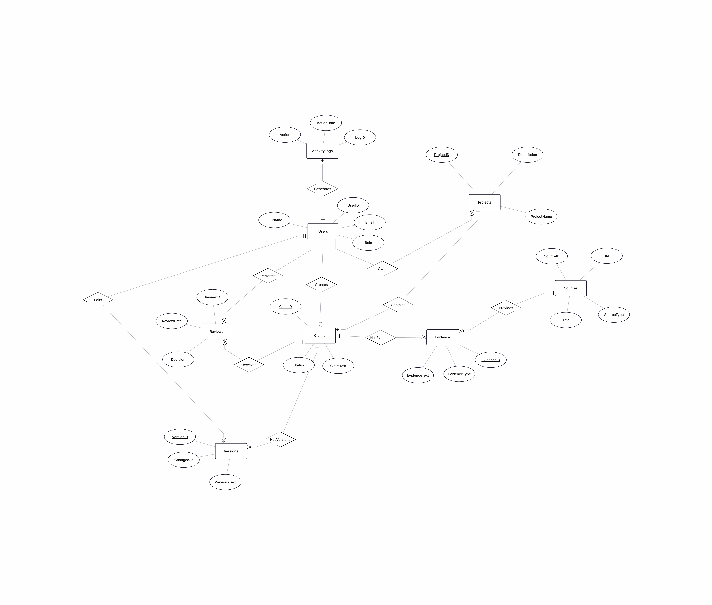

# BASMAH — Database Design Section (Draft for Final Report)

**Project:** BASMAH – Evidence & Source Tracking System  
**Section owner:** Diyam — Database Design  
**Document status:** Design diagrams prepared and schema structure checked against the team's initial MySQL DDL. ON DELETE / ON UPDATE rules, ActivityLogs trigger behavior, and business constraints remain pending team review.

## 1. Introduction and Database Design Overview

BASMAH is a proposed relational database system for organizing projects, claims, supporting sources, evidence, review decisions, and change history. The database design aims to make each claim traceable to its project, author, evidence, source, and reviewer while reducing unnecessary duplication of data. MySQL is the planned database management system.

## Problem Statement

Projects that collect claims and supporting references need a consistent way to record which source supports which claim, who submitted or reviewed it, and how it changed over time. Without structured relational records, these links can become difficult to trace and review. BASMAH proposes a centralized database to organize these connections. This is the project's intended problem to address, not a claim about a measured existing deployment.

## Objectives

1. Design a relational schema that organizes users, projects, claims, sources, evidence, reviews, and history.
2. Define clear primary keys, foreign keys, and relationships to support traceability and referential integrity.
3. Reduce avoidable duplication by separating information into related tables and documenting normalization considerations.
4. Support recording review decisions and claim changes in dedicated tables.
5. Provide a schema that the team can implement and validate using MySQL, including the SQL features required by the instructor.

## 2. Entities and Attributes

The proposed schema consists of eight entities:

| Entity | Primary Key | Main attributes | Purpose |
|---|---|---|---|
| Users | UserID | FullName, Email, Role | Store users and their roles |
| Projects | ProjectID | ProjectName, Description, OwnerID (FK) | Store projects owned by users |
| Sources | SourceID | Title, URL, SourceType | Store reference sources |
| Claims | ClaimID | ProjectID (FK), CreatedBy (FK), ClaimText, Status | Store statements to be supported and reviewed |
| Evidence | EvidenceID | ClaimID (FK), SourceID (FK), EvidenceText, EvidenceType | Link claims to sources with supporting evidence |
| Reviews | ReviewID | ClaimID (FK), ReviewerID (FK), Decision, ReviewDate | Record review decisions |
| Versions | VersionID | ClaimID (FK), ChangedBy (FK), PreviousText, ChangedAt | Record previous claim text and editor |
| ActivityLogs | LogID | UserID (FK), Action, ActionDate | Record user activity |

The full proposed types, nullability, keys, and constraints are documented in `DATA_DICTIONARY.md`.

## 3. Relationships and Cardinalities

The design currently specifies ten one-to-many (1:N) relationships:

1. Users → Projects (owns)
2. Users → Claims (creates)
3. Projects → Claims (contains)
4. Claims → Evidence (has evidence)
5. Sources → Evidence (provides)
6. Claims → Reviews (receives)
7. Users → Reviews (performs)
8. Claims → Versions (has versions)
9. Users → Versions (changes)
10. Users → ActivityLogs (generates)

The conceptual many-to-many (M:N) relationship between Claims and Sources is resolved through the associative entity Evidence. Each Evidence row refers to one Claim and one Source, and may include evidence-specific text and type. These cardinalities are represented in the current ER diagram and relational schema. See `RELATIONSHIPS.md` for the detailed descriptions and foreign-key targets.

## 4. Normalization

The proposed schema was organized to support the first three normal forms:

- **1NF:** Tables use primary keys, atomic column values, and separate rows for repeated evidence, reviews, and version events.
- **2NF:** Each proposed table uses a single-column primary key, so no partial dependency on a subset of that primary key can exist. Other candidate keys must still be considered.
- **3NF:** User, project, and source facts are stored in their respective tables rather than repeatedly copied into claims, evidence, or reviews. Formal 3NF verification requires checking all functional dependencies and business rules.

The current structure is designed toward 3NF; compliance is **not yet formally verified**. Detailed reasoning and caveats are in `NORMALIZATION.md`.

## 5. Database Architecture and Network Type

BASMAH uses a **centralized MySQL database design**. The project scope is database modeling, SQL implementation, and testing; a custom interface or interface-to-database connection is **not required** under the instructor's updated guidance.

```text
MySQL Client / SQL Editor
            |
            v
     MySQL Server
            |
            v
BASMAH Centralized Database
```

MySQL uses a **client–server access model**. If the client and server run on the same computer using `localhost`, no LAN or WAN is required. A networked deployment is not part of the current project requirements. The actual testing environment must be confirmed by the implementation team before describing it as completed. See `ARCHITECTURE.md`.

## 6. Integrity and Design Considerations

- Every proposed table has a primary key.
- Ten foreign-key columns represent the documented relationships.
- Users.Email is proposed as unique.
- Foreign keys are proposed as NOT NULL; exact deletion and update actions need team agreement.
- Deletion policies should protect review, evidence, and change history.
- Allowed status/decision/type values, timestamp defaults, and additional business constraints remain to be finalized.

## 7. ER Diagram and Relational Schema

The current ER diagram shows eight entities, their attributes and keys, and ten relationships. The relational schema shows the corresponding eight tables and ten foreign keys. The design has been checked against Jumanah's initial MySQL schema, including `Reviews.ReviewDate` as `DATETIME` and `Versions.PreviousText` as required.

### ER Diagram



Editable source: [BASMAH-ER-Diagram.erdplus](BASMAH-ER-Diagram.erdplus)

### Relational Schema


Editable source: [BASMAH-Relational Schema.erdplus](BASMAH-Relational%20Schema.erdplus)

**Note:** PNG assets must be uploaded at these relative paths for the previews above to render. Final business rules and trigger integration are pending team review.

## 8. Conclusion

The current BASMAH design documents a proposed eight-entity relational model with explicit keys and relationships. Its separation of users, projects, claims, evidence, sources, reviews, and history provides a foundation for implementing a traceable evidence-management database. The ER diagram and relational schema are prepared and have been checked against the team's initial MySQL DDL. Final approval depends on agreeing on business rules and verifying the team's final MySQL scripts.

## Related design files

- `DATA_DICTIONARY.md` — detailed table/column definitions
- `RELATIONSHIPS.md` — relationship meanings, cardinalities, foreign keys
- `NORMALIZATION.md` — 1NF, 2NF, and 3NF analysis
- `ARCHITECTURE.md` — centralized architecture and network type
